  <picture>
    <source media="(prefers-color-scheme: dark)" srcset="./dark.svg" />
    <source media="(prefers-color-scheme: light)" srcset="./light.svg" />
    
  </picture>

---

### 👋 About Me

- 🎓 **Software Engineering Student** based in **Ho Chi Minh City, Vietnam**
- 💻 Focused on **Backend Architecture**, **Database Design**, **Full-Stack Web**, and **CI/CD**
- 🛠️ Building practical, containerized web and desktop systems with clean architecture

---

### 🚀 Featured Projects

| Project | Description | Tech Stack |
| :--- | :--- | :--- |
| **TourVoice** | Hệ thống thuyết minh du lịch tự động đa ngôn ngữ | `.NET` · `MySQL` |
| **DongNamTrip** | Hệ thống quản lý đặt tour du lịch | `C#` · `SQL Server` · `Docker` |

---

### 🧰 Engineering Stack

- **Languages:** `C#` · `Java` · `Python`
- **Frameworks:** `.NET` · `Java Spring Boot`
- **Databases:** `SQL Server` · `MySQL` · `MongoDB`
- **DevOps & Tools:** `Docker` · `GitHub Actions`

---

### 📊 GitHub Contributions

  <picture>
    <source
      media="(prefers-color-scheme: dark)"
      srcset="https://raw.githubusercontent.com/K-sewii/github-snake/output/github-snake-dark.svg"
    />
    <source
      media="(prefers-color-scheme: light)"
      srcset="https://raw.githubusercontent.com/K-sewii/github-snake/output/github-snake.svg"
    />
    
  </picture>

---

### 📫 Connect With Me

- **GitHub:** [github.com/K-sewii](https://github.com/K-sewii)
- **Instagram:** [@9se.wii](https://www.instagram.com/9se.wii/)
- **Facebook:** [facebook.com/kpham2912](https://www.facebook.com/kpham2912/?locale=vi_VN)
- **Email:** [pnmk29122006@gmail.com](mailto:pnmk29122006@gmail.com)